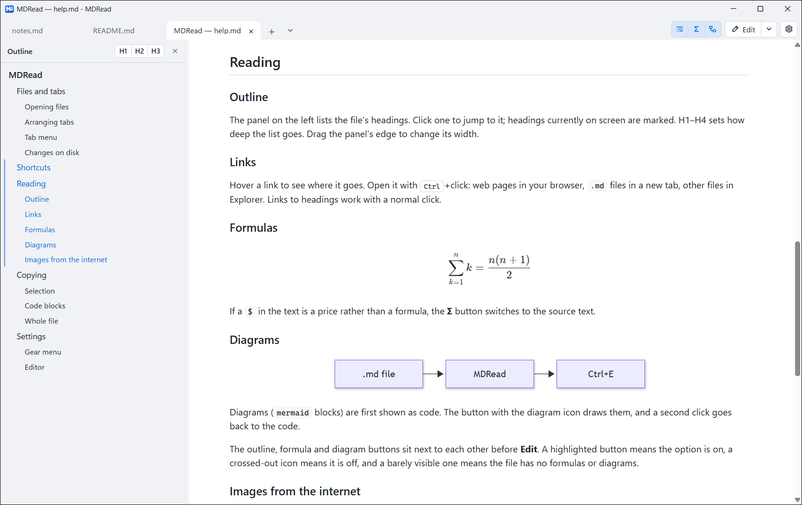
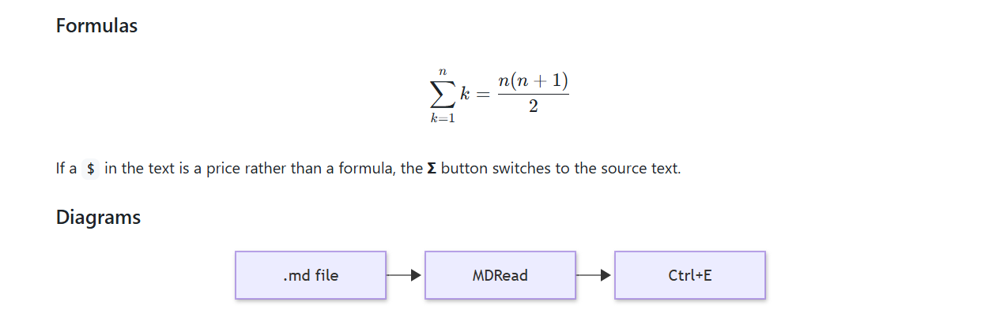
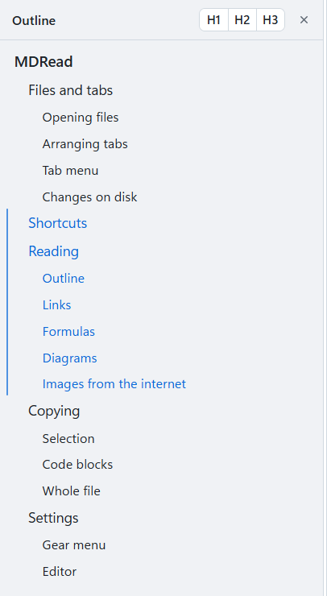
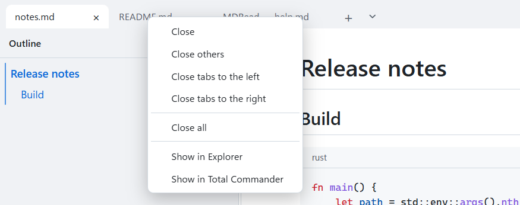
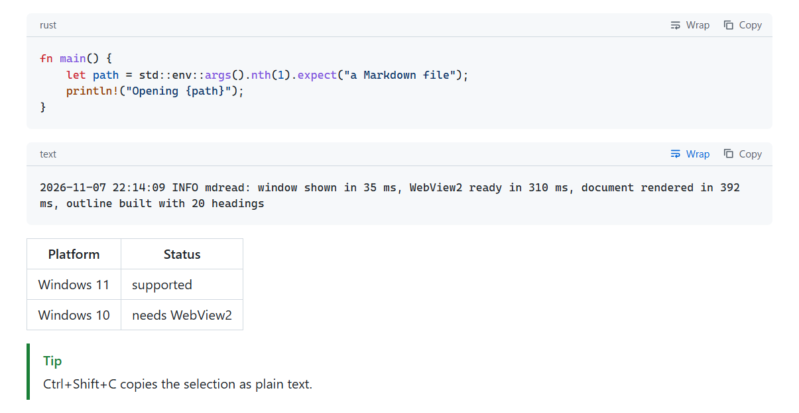
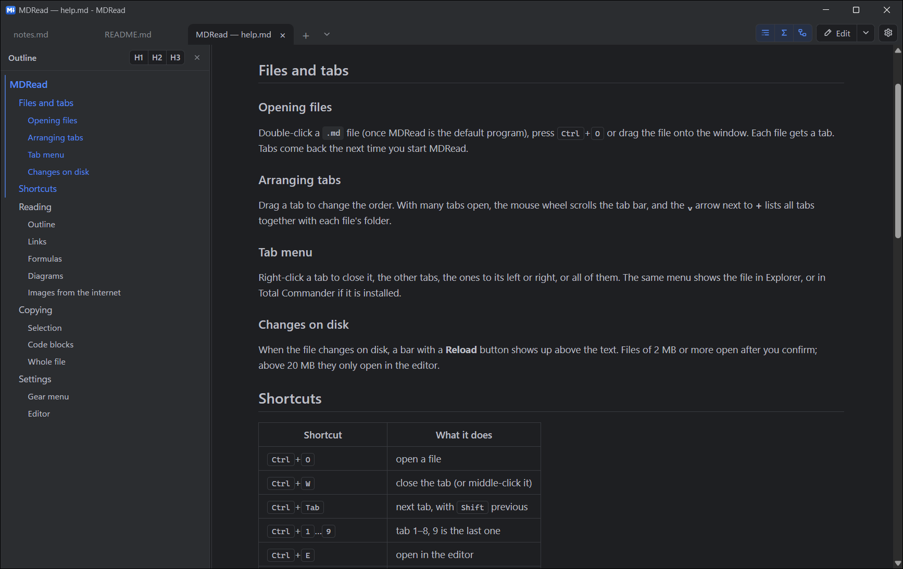

# MDRead

A small Markdown viewer for Windows. It opens `.md` files in tabs and renders GitHub-flavoured Markdown with
formulas, diagrams and code highlighting. It doesn't edit files: the **Edit** button opens the file in the
program of your choice.

Rust + Win32 + WebView2 (part of Windows 11). Markdown is rendered by [comrak](https://github.com/kivikakk/comrak)
and sanitised by [ammonia](https://github.com/rust-ammonia/ammonia).



## Features

### Reading

- GitHub-flavoured Markdown: tables, task lists, footnotes, alerts; YAML front matter is not shown.
- Formulas with KaTeX (`$…$`, `$$…$$`), Mermaid diagrams (shown as code until you switch them on),
  highlight.js for code blocks. The libraries load only when a document needs them.



### Outline

- A panel on the left lists the headings; H1–H4 sets how deep it goes and a click jumps to the heading.
- Headings currently on screen are highlighted, and the panel scrolls along with the document.



### Tabs

- One window; opening another file adds a tab. Tabs and reading positions are restored on the next start.
- Drag to reorder, a list of all tabs, and a tab menu: close others / to the left / to the right / all,
  show in Explorer or Total Commander.



### Copying

- **Ctrl+C** copies the selection with formatting but without theme colours, so it pastes cleanly into
  Word or Teams. **Ctrl+Shift+C** copies plain text.
- Each code block shows its language and has its own **Copy** button and a **Wrap** button that breaks
  long lines of that block instead of scrolling them sideways.



### Themes and language

- Five themes (GitHub, JetBrains, VS Code, Fluent, Reading), each light, dark or following Windows;
  the title bar follows the theme.
- Polish and English interface.



### Files

- A bar appears when the file changes on disk (**Reload**) or is deleted.
- Links open with **Ctrl+click**: web pages in the browser, `.md` files in a new tab, other files in Explorer.
- Remote images load only after a click, so opening a file doesn't tell anyone you read it.
- Files from 2 MB ask before opening; above 20 MB they are offered to the editor instead.

## Installation

### Built-in installer

Run `mdread.exe` without arguments from anywhere other than its install folder (for example from Downloads).
It shows an installer page with these choices:

- open `.md` files with MDRead,
- the editor used by the **Edit** button,
- shortcuts in the Start menu and on the desktop.

It copies the program to `%LOCALAPPDATA%\Programs\MDRead` for the current user only (no administrator rights),
adds an entry to *Apps & features* and starts MDRead with the help page open.

```
mdread.exe --install      show the installer page even from the install folder
mdread.exe --uninstall    uninstall after a confirmation; settings in %APPDATA%\mdread stay
```

### File association

Windows doesn't let a program make itself the default app. MDRead registers itself so it appears in
*Open with* and in *Settings → Apps → Default apps*, where you pick it. The installer opens that page for you.

```
mdread.exe --register            registry entries (HKCU) and an offer to open the default apps settings
mdread.exe --register --quiet    the same without any windows
mdread.exe --unregister          remove the entries
```

## Building

### Requirements

- Rust with the `stable-x86_64-pc-windows-msvc` toolchain (rustup).
- Visual Studio Build Tools with *Desktop development with C++* (compiler, linker and `rc.exe` from the Windows SDK).

### Commands

```
cargo build --release
```

The result is a single file, `target\release\mdread.exe`; the interface and the JavaScript libraries are embedded.
A debug build never shows the installer, so it opens an empty window when started without files.

## Files and settings

| Path | Contents |
|---|---|
| `%APPDATA%\mdread\settings.json` | theme, zoom, language, editors, open tabs, outline width and default |
| `%APPDATA%\mdread\help` | a copy of the help page, refreshed on every start |
| `%LOCALAPPDATA%\mdread` | WebView2 data |

## Measurements

### Size

`mdread.exe` (release, 2026-11-07) is 8.1 MB. About two thirds of it is the Mermaid library (5.3 MB);
the Rust code is about 2 MB.

### Startup

Measured on Windows 11 with a release build: the window appears about 35 ms after the process starts,
the document about 400 ms after (most of it is WebView2 starting). Opening takes roughly 1 s per MB of Markdown.

Set `MDREAD_TIMING=<log file>` to write the timing of each startup step.

## License

MIT, see [LICENSE](LICENSE). The embedded libraries keep their own licenses: KaTeX (MIT), Mermaid (MIT),
highlight.js (BSD-3-Clause); the gear icon follows the shape of Lucide's `settings` icon (ISC).
