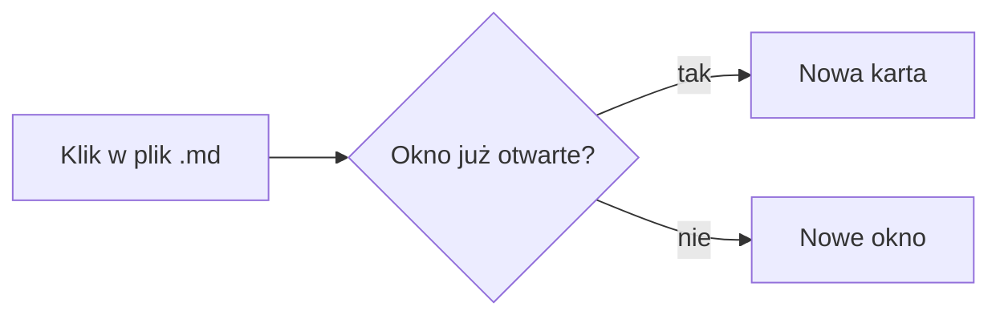

# Rozszerzenia

## Matematyka

W linii: $E = mc^2$ oraz $`\sqrt{a^2 + b^2}`$.

Blok:

$$
\int_0^\infty e^{-x^2}\,dx = \frac{\sqrt{\pi}}{2}
$$

Fałszywy alarm (nie powinien być wzorem): kosztuje 5$ a tamto 10$.

## Mermaid

## Surowy HTML (sanityzacja)

Rozwiń

Treść w `
` powinna działać.

[link javascript](javascript:alert(1))
