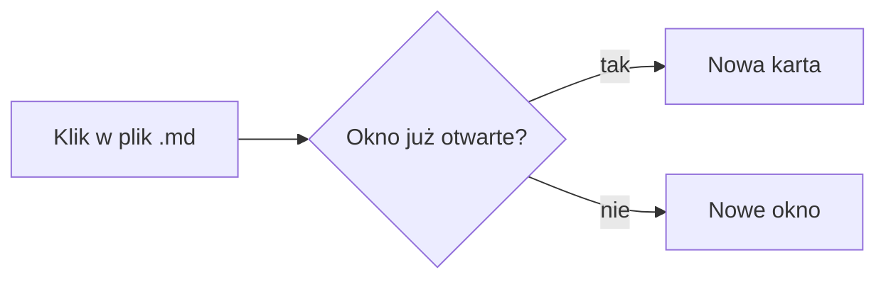
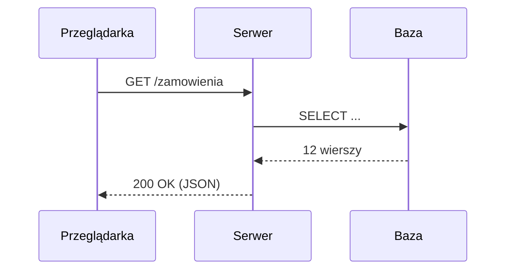
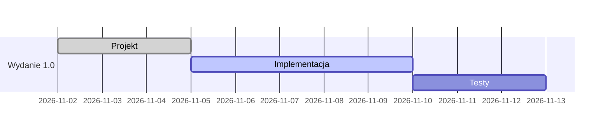
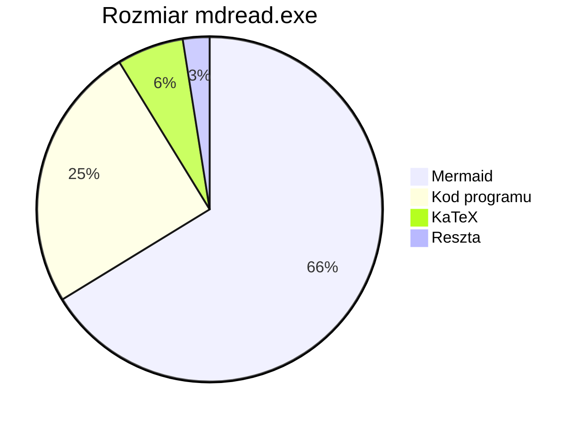
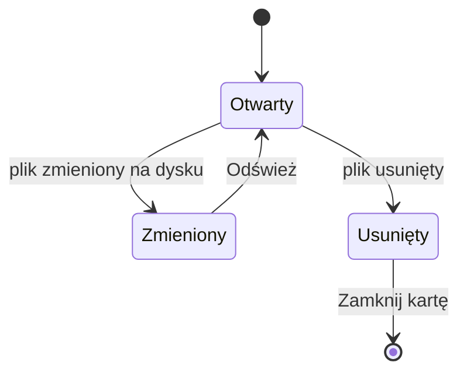

# Diagramy Mermaid

Każdy diagram poniżej to zwykły blok kodu z językiem `mermaid`. Bez Mermaida byłby pokazany jako tekst:

```text
sequenceDiagram
    Przeglądarka->>Serwer: GET /zamowienia
```

## Schemat blokowy



## Diagram sekwencji



## Harmonogram



## Wykres kołowy



## Stany


