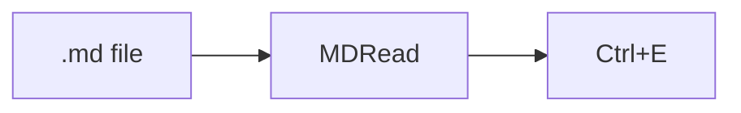

# MDRead

A Markdown file viewer. It doesn't edit files: the **Edit** button opens the file in another program.
You can come back to this page from the gear menu or with <kbd>F1</kbd>.

## Files and tabs

### Opening files

Double-click a `.md` file (once MDRead is the default program), press <kbd>Ctrl</kbd>+<kbd>O</kbd>
or drag the file onto the window. Each file gets a tab. Tabs come back the next time you start MDRead,
and so do the window's position and size.

### Arranging tabs

Drag a tab to change the order. With many tabs open, the mouse wheel scrolls the tab bar,
and the **⌄** arrow next to **+** lists all tabs together with each file's folder.

### Tab menu

Right-click a tab to close it, the other tabs, the ones to its left or right, or all of them.
The same menu shows the file in Explorer, or in Total Commander if it is installed.

### Changes on disk

When the file changes on disk, a bar with a **Reload** button shows up above the text.
Files of 2 MB or more open after you confirm; above 20 MB they only open in the editor.

## Shortcuts

| Shortcut | What it does |
|---|---|
| <kbd>Ctrl</kbd>+<kbd>O</kbd> | open a file |
| <kbd>Ctrl</kbd>+<kbd>W</kbd> | close the tab (or middle-click it) |
| <kbd>Ctrl</kbd>+<kbd>Shift</kbd>+<kbd>T</kbd> | reopen a closed tab, press again for earlier ones |
| <kbd>Ctrl</kbd>+<kbd>R</kbd>, <kbd>F5</kbd> | read the file again (images too), keeping your place |
| <kbd>Ctrl</kbd>+<kbd>Tab</kbd> | next tab, with <kbd>Shift</kbd> previous |
| <kbd>Ctrl</kbd>+<kbd>1</kbd>…<kbd>9</kbd> | tab 1–8, 9 is the last one |
| <kbd>Ctrl</kbd>+<kbd>E</kbd> | open in the editor |
| <kbd>Ctrl</kbd>+<kbd>F</kbd> | find |
| <kbd>Ctrl</kbd>+<kbd>Shift</kbd>+<kbd>O</kbd> | outline (headings) |
| <kbd>Ctrl</kbd>+<kbd>C</kbd> | copy with formatting |
| <kbd>Ctrl</kbd>+<kbd>Shift</kbd>+<kbd>C</kbd> | copy text only |
| <kbd>Ctrl</kbd>+wheel, <kbd>Ctrl</kbd>+<kbd>0</kbd> | zoom, back to 100% |

## Reading

### Outline

The panel on the left lists the file's headings. Click one to jump to it; headings currently on screen
are marked. H1–H4 sets how deep the list goes. Drag the panel's edge to change its width.

### Links

Hover a link to see where it goes. Open it with <kbd>Ctrl</kbd>+click: web pages in your browser,
`.md` files in a new tab, other files in Explorer. Links to headings work with a normal click.

### Formulas

$$
\sum_{k=1}^{n} k = \frac{n(n+1)}{2}
$$

If a `$` in the text is a price rather than a formula, the **Σ** button switches to the source text.

### Diagrams

Diagrams (`mermaid` blocks) are first shown as code. The button with the diagram icon draws them,
and a second click goes back to the code.

The outline, formula and diagram buttons sit next to each other before **Edit**. A highlighted button
means the option is on, a crossed-out icon means it is off, and a barely visible one means the file
has no formulas or diagrams.

### Images from the internet

They load only after you click them. Otherwise the author of the file could tell when it was opened.

## Copying

### Selection

Ctrl+C keeps bold text, lists and tables but not the theme colours, so text pasted into Word or Teams
has normal colours. Formulas are copied as source, e.g. `$E = mc^2$`.

### Code blocks

Each code block has a **Copy** button that copies the code without the rest of the page, and a **Wrap**
button that breaks long lines of that block instead of scrolling them sideways.

### Whole file

The right-click menu can copy the Markdown source of the whole file.

## Settings

### Gear menu

Theme (light, dark or same as Windows), language, whether new files open with the outline,
the automatic update check and this help.

### Updates

The installed MDRead checks GitHub once a day for a newer version. If there is one, a bar at the bottom
of the window offers **Install and restart**: the program downloads the new version, checks its checksum
and starts again with the same tabs. Nothing is downloaded without that click. You can turn the check
off in the gear menu. When you turn it back on, the bar shows right away whether you have the latest version.

### Editor

**Edit ▾** lets you pick the editing program or add your own.

## Why only a viewer

Most Markdown files are read far more often than they are written: Claude's plans, documentation, READMEs.
For that, the usual tools fall short. Windows Notepad shows only basic Markdown, with no diagrams or
formulas. Notepad++ needs a plugin, and you can't copy text from its preview. VS Code and PhpStorm
render everything, but they take too long to start just to read one file. MDRead opens a `.md` file
instantly and shows all of it. When you do want to change something, <kbd>Ctrl</kbd>+<kbd>E</kbd> opens
the file in your favourite editor.

Want to edit files in MDRead itself, or add other features? Feel free to clone the project and vibe it yourself! 😊
