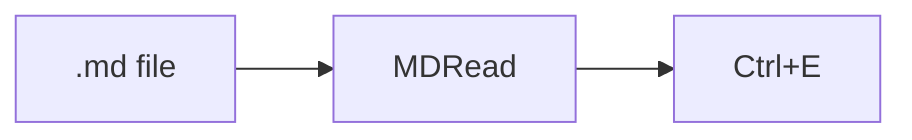

# MDRead

A Markdown file viewer. It doesn't edit files: the **Edit** button opens the file in another program.
You can come back to this page with the **?** button or <kbd>F1</kbd>.

## Opening files

Double-click a `.md` file (once MDRead is the default program), press <kbd>Ctrl</kbd>+<kbd>O</kbd>
or drag the file onto the window. Each file gets a tab. Tabs come back the next time you start MDRead.

## Shortcuts

| Shortcut | What it does |
|---|---|
| <kbd>Ctrl</kbd>+<kbd>O</kbd> | open a file |
| <kbd>Ctrl</kbd>+<kbd>W</kbd> | close the tab (or middle-click it) |
| <kbd>Ctrl</kbd>+<kbd>Tab</kbd> | next tab, with <kbd>Shift</kbd> previous |
| <kbd>Ctrl</kbd>+<kbd>1</kbd>…<kbd>9</kbd> | tab 1–8, 9 is the last one |
| <kbd>Ctrl</kbd>+<kbd>E</kbd> | open in the editor |
| <kbd>Ctrl</kbd>+<kbd>F</kbd> | find |
| <kbd>Ctrl</kbd>+<kbd>C</kbd> | copy with formatting |
| <kbd>Ctrl</kbd>+<kbd>Shift</kbd>+<kbd>C</kbd> | copy text only |
| <kbd>Ctrl</kbd>+wheel, <kbd>Ctrl</kbd>+<kbd>0</kbd> | zoom, back to 100% |

## Copying

Ctrl+C keeps bold text, lists and tables but not the theme colours, so text pasted into Word or Teams
has normal colours. Formulas are copied as source, e.g. `$E = mc^2$`.
The right-click menu can also copy the Markdown source of the whole file.

## Links

Hover a link to see where it goes. Open it with <kbd>Ctrl</kbd>+click: web pages in your browser,
`.md` files in a new tab, other files in Explorer. Links to headings work with a normal click.

## Formulas and diagrams

$$
\sum_{k=1}^{n} k = \frac{n(n+1)}{2}
$$

If a `$` in the text is a price rather than a formula, the **Math** button switches to the source text.

## Other things

- **Edit ▾** lets you pick the editing program or add your own.
- When the file changes on disk, a bar with a **Reload** button shows up above the text.
- **Appearance**: theme (light, dark or same as Windows) and language.
- Images from the internet load only after you click them. Otherwise the author of the file could tell when you opened it.
- Files of 2 MB or more open after you confirm; above 20 MB they only open in the editor.
