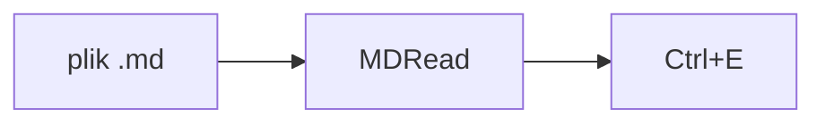

# MDRead

Przeglądarka plików Markdown. Plików nie edytuje: przycisk **Edytuj** otwiera plik w innym programie.
Tę stronę otworzysz ponownie z menu zębatki albo klawiszem <kbd>F1</kbd>.

## Pliki i karty

### Otwieranie

Plik `.md` otworzysz dwuklikiem (gdy MDRead jest domyślnym programem), przez <kbd>Ctrl</kbd>+<kbd>O</kbd>
albo przeciągając go do okna. Każdy plik dostaje kartę. Przy następnym uruchomieniu wracają karty
i okno w tym samym miejscu i rozmiarze.

### Układanie kart

Kolejność kart zmienia się, przeciągając kartę myszą. Gdy kart jest dużo, pasek przewija się kółkiem,
a strzałka **⌄** obok **+** pokazuje listę wszystkich kart z folderem każdego pliku.

### Menu karty

Prawy przycisk na karcie zamyka ją, pozostałe, te po lewej lub prawej albo wszystkie.
Stamtąd też pokażesz plik w Eksploratorze albo w Total Commanderze, jeśli jest zainstalowany.

### Zmiany na dysku

Gdy plik zmieni się na dysku, nad treścią pojawi się pasek z przyciskiem **Odśwież**.
Pliki od 2 MB otwierają się po potwierdzeniu, a powyżej 20 MB tylko w edytorze.

## Skróty

| Skrót | Co robi |
|---|---|
| <kbd>Ctrl</kbd>+<kbd>O</kbd> | otwórz plik |
| <kbd>Ctrl</kbd>+<kbd>W</kbd> | zamknij kartę (albo środkowy przycisk myszy) |
| <kbd>Ctrl</kbd>+<kbd>Tab</kbd> | następna karta, z <kbd>Shift</kbd> poprzednia |
| <kbd>Ctrl</kbd>+<kbd>1</kbd>…<kbd>9</kbd> | karta nr 1–8, 9 to ostatnia |
| <kbd>Ctrl</kbd>+<kbd>E</kbd> | otwórz w edytorze |
| <kbd>Ctrl</kbd>+<kbd>F</kbd> | szukaj |
| <kbd>Ctrl</kbd>+<kbd>Shift</kbd>+<kbd>O</kbd> | spis treści (nagłówki) |
| <kbd>Ctrl</kbd>+<kbd>C</kbd> | kopiuj z formatowaniem |
| <kbd>Ctrl</kbd>+<kbd>Shift</kbd>+<kbd>C</kbd> | kopiuj sam tekst |
| <kbd>Ctrl</kbd>+kółko, <kbd>Ctrl</kbd>+<kbd>0</kbd> | powiększenie, powrót do 100% |

## Czytanie

### Spis treści

Panel z lewej pokazuje nagłówki pliku. Kliknięcie przenosi do nagłówka, a nagłówki widoczne
na ekranie są zaznaczone. H1–H4 ustawia, do którego poziomu sięga lista. Szerokość panelu
zmienisz, przeciągając jego krawędź.

### Linki

Adres widać po najechaniu na link. Otwiera się go z <kbd>Ctrl</kbd>: strony w przeglądarce,
pliki `.md` w nowej karcie, inne pliki w Eksploratorze. Odnośniki do nagłówków działają zwykłym kliknięciem.

### Wzory

$$
\sum_{k=1}^{n} k = \frac{n(n+1)}{2}
$$

Jeśli `$` w tekście oznacza cenę, a nie wzór, przycisk **Σ** na pasku przełącza na tekst źródłowy.

### Diagramy

Diagramy (bloki `mermaid`) są najpierw pokazane jako kod. Rysuje je przycisk z ikoną schematu na pasku,
a drugie kliknięcie wraca do kodu.

Przyciski spisu treści, wzorów i diagramów są obok siebie przed **Edytuj**. Podświetlony przycisk
oznacza opcję włączoną, przekreślona ikona wyłączoną, a ledwo widoczna, że w pliku nie ma wzorów
albo diagramów.

### Obrazki z internetu

Wczytują się dopiero po kliknięciu. Inaczej autor pliku mógłby sprawdzić, kiedy plik został otwarty.

## Kopiowanie

### Zaznaczenie

Ctrl+C zachowuje pogrubienia, listy i tabele, ale nie przenosi kolorów motywu, więc po wklejeniu do Worda
czy Teams tekst ma zwykłe kolory. Wzory kopiują się jako źródło, np. `$E = mc^2$`.

### Bloki kodu

Nad każdym blokiem kodu jest przycisk **Kopiuj**, który bierze sam kod, i **Zawijaj**, który łamie
długie wiersze tego bloku zamiast przewijać je w poziomie.

### Cały plik

Pod prawym przyciskiem myszy jest kopiowanie źródła Markdown całego pliku.

## Ustawienia

### Zębatka

Motyw (jasny, ciemny albo jak w systemie), język, to, czy nowe pliki otwierają się ze spisem treści,
automatyczne sprawdzanie aktualizacji i ta pomoc.

### Aktualizacje

Zainstalowany MDRead raz dziennie sprawdza na GitHubie, czy jest nowsza wersja. Jeśli jest, na dole okna
pojawi się pasek z przyciskiem **Zainstaluj i uruchom ponownie**: program pobierze nową wersję, sprawdzi
jej sumę kontrolną i uruchomi się od nowa z tymi samymi kartami. Bez kliknięcia nic nie jest pobierane.
Sprawdzanie wyłączysz w zębatce. Po jego włączeniu pasek od razu pokaże, czy masz najnowszą wersję.

### Edytor

**Edytuj ▾** pozwala wybrać program do edycji albo dodać własny.
