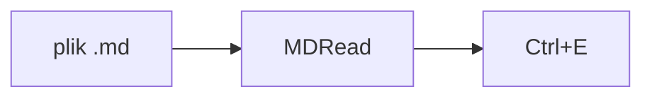

# MDRead

Przeglądarka plików Markdown. Plików nie edytuje: przycisk **Edytuj** otwiera plik w innym programie.
Tę stronę otworzysz ponownie przyciskiem **?** albo klawiszem <kbd>F1</kbd>.

## Otwieranie

Plik `.md` otworzysz dwuklikiem (gdy MDRead jest domyślnym programem), przez <kbd>Ctrl</kbd>+<kbd>O</kbd>
albo przeciągając go do okna. Każdy plik dostaje kartę. Przy następnym uruchomieniu karty wracają.

## Skróty

| Skrót | Co robi |
|---|---|
| <kbd>Ctrl</kbd>+<kbd>O</kbd> | otwórz plik |
| <kbd>Ctrl</kbd>+<kbd>W</kbd> | zamknij kartę (albo środkowy przycisk myszy) |
| <kbd>Ctrl</kbd>+<kbd>Tab</kbd> | następna karta, z <kbd>Shift</kbd> poprzednia |
| <kbd>Ctrl</kbd>+<kbd>1</kbd>…<kbd>9</kbd> | karta nr 1–8, 9 to ostatnia |
| <kbd>Ctrl</kbd>+<kbd>E</kbd> | otwórz w edytorze |
| <kbd>Ctrl</kbd>+<kbd>F</kbd> | szukaj |
| <kbd>Ctrl</kbd>+<kbd>C</kbd> | kopiuj z formatowaniem |
| <kbd>Ctrl</kbd>+<kbd>Shift</kbd>+<kbd>C</kbd> | kopiuj sam tekst |
| <kbd>Ctrl</kbd>+kółko, <kbd>Ctrl</kbd>+<kbd>0</kbd> | powiększenie, powrót do 100% |

## Kopiowanie

Ctrl+C zachowuje pogrubienia, listy i tabele, ale nie przenosi kolorów motywu, więc po wklejeniu do Worda
czy Teams tekst ma zwykłe kolory. Wzory kopiują się jako źródło, np. `$E = mc^2$`.
Pod prawym przyciskiem myszy jest też kopiowanie źródła Markdown całego pliku.

## Linki

Adres widać po najechaniu na link. Otwiera się go z <kbd>Ctrl</kbd>: strony w przeglądarce,
pliki `.md` w nowej karcie, inne pliki w Eksploratorze. Odnośniki do nagłówków działają zwykłym kliknięciem.

## Wzory i diagramy

$$
\sum_{k=1}^{n} k = \frac{n(n+1)}{2}
$$

Diagramy (bloki `mermaid`) są najpierw pokazane jako kod. Rysuje je przycisk z ikoną schematu na pasku,
a drugie kliknięcie wraca do kodu. Jeśli `$` w tekście oznacza cenę, a nie wzór, przycisk **Σ** przełącza
na tekst źródłowy. Przekreślona ikona znaczy, że dana opcja jest wyłączona.

## Inne

- **Edytuj ▾** pozwala wybrać program do edycji albo dodać własny.
- Gdy plik zmieni się na dysku, nad treścią pojawi się pasek z przyciskiem **Odśwież**.
- Zębatka: motyw (jasny, ciemny albo jak w systemie) i język.
- Obrazki z internetu wczytują się dopiero po kliknięciu. Inaczej autor pliku mógłby sprawdzić, kiedy go otworzyłeś.
- Pliki od 2 MB otwierają się po potwierdzeniu, a powyżej 20 MB tylko w edytorze.
